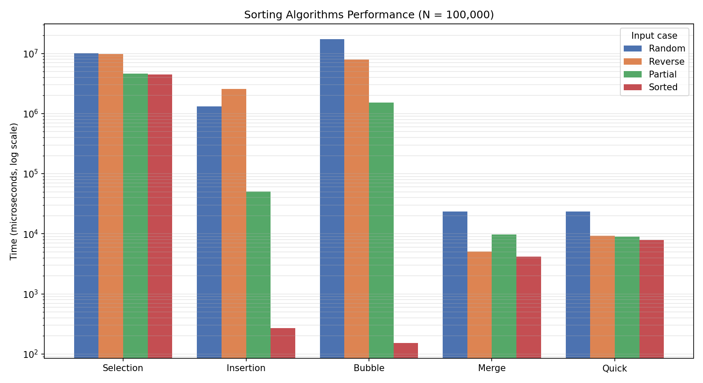

# Sorting Algorithms Benchmark

## Student Information

- Name: [محمود إبراهيم ابورزيزة ]

- Student ID: [3168241]

- Section: [B]

- Project: Sorting Algorithms Benchmark

- Language: Java

## Project Description

This project compares the performance of five sorting algorithms using Java.

The program sorts arrays containing 100,000 elements and measures the execution time of each algorithm using System.nanoTime().

## Sorting Algorithms

The five algorithms used in this project are:

1. Selection Sort

2. Insertion Sort

3. Bubble Sort

4. Merge Sort

5. Quick Sort

## Input Test Cases

Each algorithm is tested using four different input cases:

1. Random Array

2. Reverse Sorted Array

3. Partially Sorted Array (80% sorted)

4. Fully Sorted Array

Array Size: 100,000 elements.

## Time Complexity

| Algorithm | Average Case | Worst Case |

|—|—|—|

| Selection Sort | O(N²) | O(N²) |

| Insertion Sort | O(N²) | O(N²) |

| Bubble Sort | O(N²) | O(N²) |

| Merge Sort | O(N log N) | O(N log N) |

| Quick Sort | O(N log N) | O(N²) |

## Performance Results

Execution time is measured in microseconds (µs).

| Algorithm | Random | Reverse | Partial | Sorted |

|—|—:|—:|—:|—:|

| Selection Sort | 10041993 | 9750265 | 4599279 | 4435836 |

| Insertion Sort | 1308295 | 2561201 | 50801 | 268 |

| Bubble Sort | 17364781 | 7859344 | 1531552 | 152 |

| Merge Sort | 23478 | 5094 | 9746 | 4168 |

| Quick Sort | 23522 | 9298 | 8953 | 7904 |

## Performance Chart



    bar [10041993, 1308295, 17364781, 23478, 23522]
```   
